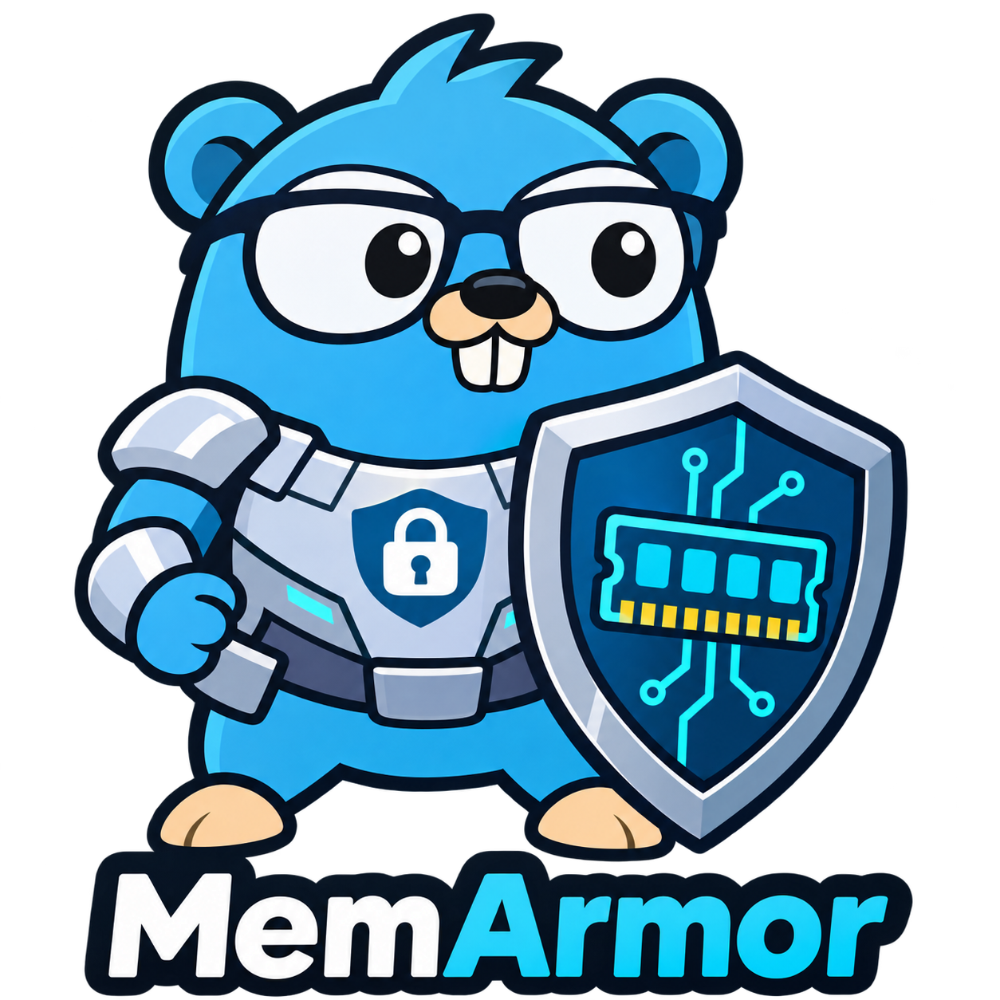

  
  <h3 align="center">memarmor</h3>
  
Hardened software enclave for sensitive data in Go memory.

  
The Go gopher was designed by Renée French and is used under CC-BY 4.0. See <a href="https://go.dev/blog/gopher">the Go Gopher</a>.

---

memarmor is a security-hardened memory-protection library for Go, derived
from [memguard](https://github.com/awnumar/memguard). It keeps secrets
encrypted and guarded while they sit in process memory, and assumes a
stronger threat model than upstream: heap hygiene, hardware-backed keys,
and authenticated container integrity.

## Status

Implemented and verified: the full test suite passes with `-race`, plus
`go vet`, `gofmt`, benchmarks, and cross-compiles for Windows, macOS, and
FreeBSD. The TPM seal backend is covered by backend tests and a
hardware-gated integration test that runs where a TPM 2.0 is accessible.

## Features

* Choice of authenticated cipher for sealed data: XSalsa20-Poly1305
  (default) or AES-256-GCM-SIV (RFC 8452). Ciphertext is self-describing,
  so either kind always opens.
* TPM 2.0 integration: the session key is sealed to the platform TPM when
  one is available, with optional PCR policy binding, and can be locked
  (evicted from RAM) and unlocked on demand.
* Per-enclave data keys: every sealed container uses a unique data key
  wrapped by the versioned session key, isolating nonces across enclaves.
* Authenticated streams: chunks are bound to their stream and position,
  and closing a stream commits a length readers use to detect truncation.
* Memory hygiene: runtime-guaranteed wipes, in-place decryption with no
  heap plaintext copies, stack-only intermediate digests, and explicit
  destruction of ciphertext containers.
* Safer API surface: typed views return copies instead of aliasing locked
  memory, copies fail loudly on overflow, and resource exhaustion returns
  errors instead of panicking.
* Vendored syscall and TPM layers: no dependency on external `memcall`
  or `go-tpm` modules.

## Relation to memguard

memarmor started from memguard and keeps its core architecture of locked
buffers, sealed enclaves, guard pages, canaries, and session purging. All
memguard license and attribution details are kept in
[THIRD-PARTY-LICENSE](THIRD-PARTY-LICENSE).

## License

Copyright 2026 Marc Gauthier.

memarmor is licensed under the Apache License, Version 2.0. See
[LICENSE](LICENSE) for the full text.
